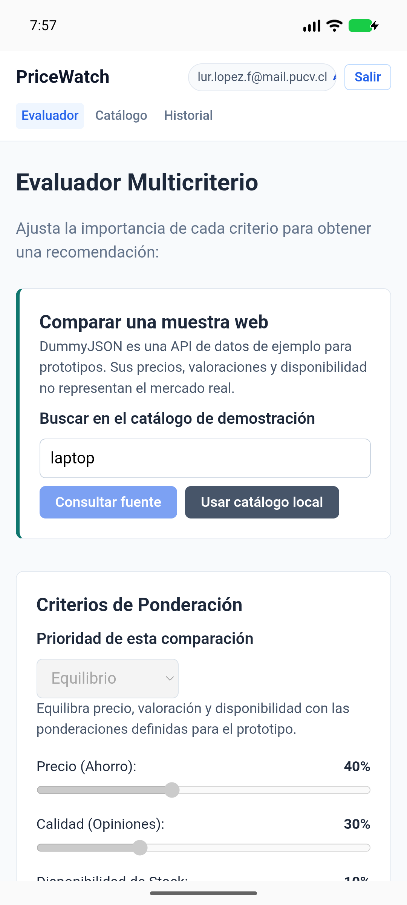

# PriceWatch — Comparador Multicriterio Inteligente

> **Asignatura:** OII436-1 Ingeniería Web Avanzada — PUCV
> **Autor:** Lur Lopez Fraile (`lur.lopez.f@mail.pucv.cl`)
> **Entrega actual:** EF — solución desplegable con autenticación, PWA y Android
> **Estado:** autenticación JWT/roles, PWA instalable y APK Android generados; la fuente aporta datos sintéticos de demostración

PriceWatch compara productos de comercio electrónico con **múltiples criterios ponderables por el usuario** (precio, calidad, stock y especificaciones) y entrega un ranking **explicable**: no solo dice qué producto conviene, sino por qué, mostrando la normalización y el aporte de cada criterio al puntaje final.

---

## 1. Definición del proyecto

### 1.1 Problema

Los comparadores de precios actuales ordenan el catálogo por un **criterio único**: el precio más bajo o el producto patrocinado por el comercio. Esto ignora las prioridades reales de cada comprador (por ejemplo, alguien que valora más la calidad o la disponibilidad) y no es transparente: el usuario no sabe por qué un producto aparece primero.

### 1.2 Usuarios objetivo

| Perfil | Necesidad principal |
|---|---|
| Compradores analíticos | Comparaciones objetivas con evidencia, no publicidad |
| Profesionales técnicos | Ponderar especificaciones por sobre el precio |
| Usuarios con presupuesto acotado | Maximizar relación precio/beneficio con control del peso del precio |
| Administradores y auditores | Revisar el criterio de evaluación y el historial de rankings |

### 1.3 Objetivos

1. Implementar una evaluación multicriterio ponderable mediante el método **MAUT** con normalización **Min-Max**.
2. Entregar resultados **explicables**: desglose por criterio, aportes ponderados y justificación textual.
3. Construir una arquitectura web de tres capas (cliente, API gateway, motor analítico) con persistencia real.
4. Automatizar la calidad y seguridad con un pipeline **DevSecOps** que bloquee entregas defectuosas.
5. Lograr una aplicación adaptable a escritorio, web móvil y Android.

### 1.4 Alcance de EP1

**Incluye:**

- Flujo vertical mínimo funcional: frontend Ionic → API NestJS → motor FastAPI → PostgreSQL.
- Catálogo de productos persistido en PostgreSQL con esquema Prisma y seed.
- Evaluación multicriterio con degradación elegante ante fallos del motor.
- Autenticación básica con token Bearer (credenciales por variables de entorno).
- Contenerización completa con Docker Compose y pipeline CI/CD en GitHub Actions.
- Documentación de proyecto, arquitectura y decisiones (ADRs).

**Alcance de EP2:**

- Obtención acotada desde una API de demostración, preparación trazable y métricas de calidad.
- Perfiles de prioridad explicables y editables por el usuario, aplicados al ranking.
- Persistencia de corridas, registros normalizados y del perfil usado en cada evaluación.
- No se integran ofertas comerciales reales ni se consulta Mercado Libre.

**Fuera de alcance en esta entrega:** usuarios persistidos con roles, refresh tokens y alertas de precio. La autenticación sigue siendo la básica de EP1 y queda registrada como trabajo futuro.

### 1.5 Funcionalidades

| # | Funcionalidad | Descripción |
|---|---|---|
| F1 | Catálogo | Lista de productos con precio, categoría, marca, calidad, stock y specs; búsqueda por texto y filtro por categoría en la API |
| F2 | Evaluador ponderado | 4 sliders (precio, calidad, stock, specs); los pesos se normalizan si no suman 1 |
| F3 | Ranking explicado | Posición, puntaje 0–100, nivel y desglose por criterio con aportes ponderados |
| F4 | Explicación global | Producto ganador, texto explicativo y advertencias de stock crítico o agotado |
| F5 | Historial | Registro persistido de cada evaluación (pesos, ganador, explicación y fecha) |
| F6 | Salud del sistema | `GET /api/health` verifica NestJS + PostgreSQL + FastAPI |
| F7 | Login básico | `POST /api/auth/login` valida contra variables de entorno y emite token Bearer |
| F8 | Degradación elegante | Si FastAPI falla, NestJS responde `success_fallback` con un ranking de respaldo, nunca un error 500 |
| F9 | Autenticación y autorización | JWT con expiración, contraseñas con `bcrypt`, roles `ADMIN`/`USER`, guards de ruta y protección de endpoints |
| F10 | PWA y Android | Manifest, service worker, iconos, instalación, caché del catálogo y aviso offline; APK Android con Capacitor |

**Niveles del ranking:** `>= 80` Altamente Recomendado · `>= 60` Recomendado · `>= 40` Aceptable · `< 40` No Favorable.

### 1.6 Fuente web

- **EP1:** catálogo local de productos de ejemplo cargado por seed.
- **EP2:** [DummyJSON Products Search](https://dummyjson.com/docs/products), API que declara ofrecer datos de ejemplo para pruebas y prototipos. La consulta es manual, solicita una página (máximo 20 registros), usa timeout y valida/deduplica antes de persistir la corrida.
- **Límite:** sus precios, valoraciones y disponibilidad son sintéticos; la API no declara moneda. No se presentan como precios ni stock reales y se descartan imágenes, reseñas y datos de personas.
- Mercado Libre no se integra: sus términos contienen restricciones sobre productos que compiten con sus servicios, y el acceso observado sin autorización respondió 403. Su uso requiere revisión y permiso; no se eluden controles.

### 1.7 Capacidad adaptativa

- **Adaptación por reglas:** perfiles `economia`, `equilibrado` y `valoraciones` proponen pesos iniciales; `personalizado` permite ajustarlos.
- **Transparencia:** se omiten criterios sin datos comparables, se renormalizan los pesos disponibles y se muestran los criterios usados/omitidos. No hay entrenamiento ni inferencia de datos personales.
- **Interfaz adaptable:** diseño responsive con Angular e Ionic para escritorio, tablet y móvil.
- **Multiplataforma:** la configuración de Capacitor (`capacitor.config.ts`) deja preparado el empaquetado Android; el proyecto nativo no se versiona en esta entrega.
- **Sistema tolerante a fallos:** timeouts de 4 s hacia el motor analítico y fallback con advertencia explícita al usuario.
- **Arquitectura escalable:** servicios desacoplados (NestJS orquesta, FastAPI calcula) que pueden escalar o reemplazarse de forma independiente.

---

## 2. Arquitectura

```text
Navegador / móvil
        │  Angular + Ionic (4200 / Nginx :80)
        │  GET /api/products · POST /api/sources/demo-products/search
        │  POST /api/ranking/evaluate
        ▼
NestJS API Gateway (3000)
  ├── JWT + roles (ADMIN/USER) ── bcrypt
  ├── Prisma ORM ──────► PostgreSQL 16 (5432)
  └── HTTP ─► FastAPI (8000) ── adquisición/preparación + MAUT + explicación
                           └── HTTPS puntual ─► DummyJSON (datos de demostración)
```

| Capa | Tecnología |
|---|---|
| Frontend | Ionic 9 + Angular 21 standalone + Capacitor + Nginx |
| Backend | NestJS 11 + Prisma ORM + class-validator + Swagger |
| Base de datos | PostgreSQL 16 (Docker + volumen persistente) |
| Motor analítico | Python 3.12 + FastAPI + MAUT (Min-Max), preparación de fuente y adaptación por reglas |
| Infraestructura | Docker Compose + Terraform (provider local, staging) |
| CI/CD | GitHub Actions: lint, tests, auditoría, Gitleaks, quality gate |
| Calidad | oxlint, flake8, pytest, Jest y Vitest |

---

## 3. Estructura del repositorio

```text
PriceWatch/
├── .github/workflows/ci.yml     # Pipeline DevSecOps
├── backend/                     # API NestJS + Prisma
├── frontend/                    # Cliente Ionic + Angular + Capacitor
├── python-service/              # Motor MAUT y preparación de fuente en FastAPI
├── infra/                       # Terraform (staging)
├── ep2/                         # Plan, decisión de fuente y guía de EP2
├── .env.example                 # Plantilla de variables (versionada)
├── .editorconfig
├── CONTRIBUTING.md
└── README.md
```

> La base EP1 y el flujo EP2 están implementados. Para la demostración se recomienda reconstruir las imágenes (`docker compose up --build -d`) y verificar los servicios con `docker compose ps`.

---

## 4. Instalación

### 4.1 Docker Compose (recomendado)

```bash
cp .env.example .env          # editar contraseñas y habilitar la API de muestra localmente
# En .env: DEMO_PRODUCTS_SOURCE_ENABLED=true
# Si 3000 está ocupado, usar BACKEND_PORT=3001 y ajustar los curl a ese puerto.
docker compose config -q
docker compose up --build -d
docker compose ps
curl localhost:8000/health
curl localhost:3000/api/health
curl localhost:3000/api/products
```

El stack levanta cuatro servicios: PostgreSQL, FastAPI, NestJS y Nginx. La interfaz web queda en `http://localhost:4200` (o `FRONTEND_PORT`). Para detener: `docker compose down` (agregar `-v` solo si se quiere borrar la base).

Al iniciar, el backend ejecuta `prisma migrate deploy` y el seed de productos y usuarios. Si la base fue creada con `prisma db push` en EP1/EP2, el entrypoint detecta el estado y marca la migración base como aplicada sin borrar los datos existentes. Las credenciales de los usuarios seed se toman de `ADMIN_*` y `DEMO_USER_*`; `JWT_SECRET` firma los tokens.

Si un puerto está ocupado, revisa el proceso con `ss -ltnp | grep :PUERTO` y deténlo, o cambia `POSTGRES_PORT`, `PYTHON_PORT`, `BACKEND_PORT` o `FRONTEND_PORT` en `.env` antes de levantar el stack.

### 4.2 Ejecución manual (desarrollo)

**Base de datos:**

```bash
docker run -d --name pw-db -e POSTGRES_PASSWORD=pricewatch \
  -e POSTGRES_USER=pricewatch_admin -e POSTGRES_DB=pricewatch_db \
  -p 5432:5432 postgres:16-alpine
```

**Motor analítico (Python):**

```bash
cd python-service
python3 -m venv .venv && source .venv/bin/activate
pip install -r requirements.txt -r requirements-dev.txt
export DEMO_PRODUCTS_SOURCE_ENABLED=true
uvicorn main:app --port 8000 --reload
```

**Backend (NestJS):**

```bash
cd backend
npm ci
npx prisma generate
npx prisma db push
npx prisma db seed
export DEMO_PRODUCTS_SOURCE_ENABLED=true
npm run start:dev
```

> Al ejecutar fuera de Docker, ajustar `DATABASE_URL` y `PYTHON_SERVICE_URL` en `.env` para usar `localhost` en vez de los nombres de servicio.
> La bandera `DEMO_PRODUCTS_SOURCE_ENABLED=true` debe estar disponible tanto para NestJS como para FastAPI durante una demo local; no habilitarla en staging público sin protección de acceso.

**Frontend (Ionic):**

```bash
cd frontend
npm ci
npm start                     # proxy /api → http://localhost:3000
```

---

## 5. Contratos de API

| Método | Endpoint (NestJS :3000) | Descripción |
|---|---|---|
| `GET` | `/api/health` | Estado de NestJS + PostgreSQL + FastAPI |
| `GET` | `/api/docs` | Swagger / OpenAPI |
| `POST` | `/api/auth/login` | Login con email/contraseña → token JWT |
| `GET` | `/api/auth/me` | Perfil del usuario autenticado (JWT) |
| `POST` | `/api/auth/logout` | Cierre de sesión del cliente (JWT) |
| `GET` | `/api/products?category=` | Catálogo desde PostgreSQL (público) |
| `GET` | `/api/products/:id` | Detalle de producto (público) |
| `POST` | `/api/ranking/evaluate` | Evaluación multicriterio (USER/ADMIN) |
| `GET` | `/api/ranking/history` | Historial del usuario autenticado (USER/ADMIN) |
| `POST` | `/api/sources/demo-products/search` | Consulta a DummyJSON (solo ADMIN) |
| `GET` | `/api/sources/demo-products/runs` | Corridas de fuente (solo ADMIN) |
| `GET` | `/api/sources/demo-products/runs/:id` | Corrida y registros normalizados (solo ADMIN) |
| `GET` | `/health` (FastAPI :8000) | Salud del motor analítico |
| `POST` | `/evaluate` (FastAPI :8000) | Cálculo MAUT |
| `POST` | `/sources/demo-products/search` (FastAPI :8000) | Consulta interna de la API de muestra |

**Búsqueda explícita de una muestra:**

```json
POST /api/sources/demo-products/search
{
  "query": "laptop",
  "limit": 10,
  "acknowledged": true
}
```

La respuesta contiene `run_id`, fecha, métricas y registros normalizados con `content_hash` y `source_url`. Para comparar esa muestra, incluye el `run_id` en `POST /api/ranking/evaluate`; no mezcles valores de moneda desconocida con el catálogo local.

**Payload `POST /api/ranking/evaluate`:**

```json
{
  "weights": {
    "weight_price": 0.35,
    "weight_quality": 0.30,
    "weight_stock": 0.15,
    "weight_specs": 0.20
  },
  "context_profile": "equilibrado",
  "category": "Laptops"
}
```

Para evaluar una corrida obtenida desde la fuente, añade `"source_run_id": "<id de corrida>"`.
Los perfiles admitidos son `economia`, `equilibrado`, `valoraciones` y `personalizado`.
Los criterios ausentes en uno o más productos se omiten para toda la muestra y los pesos restantes se normalizan.

---

## 6. Seguridad y autorización

- **Contraseñas:** almacenadas con `bcrypt` (10 rondas); nunca se devuelven en las respuestas.
- **Tokens:** JWT firmado con `JWT_SECRET`, expiración configurable con `JWT_EXPIRES_IN` (por defecto `1h`).
- **Roles:** `ADMIN` y `USER`. El rol viaja en el token y se valida con `JwtAuthGuard` + `RolesGuard`.
- **Endpoints públicos:** catálogo y salud. **USER:** evaluación e historial propio. **ADMIN:** consulta de fuentes y visionado global del historial.
- **Frontend:** `authInterceptor` añade el token, `authGuard` protege evaluador e historial, y un 401 limpia la sesión y redirige al login.
- **Migraciones:** el backend aplica `prisma migrate deploy` al iniciar; si detecta una base creada con `db push`, marca la migración base como aplicada sin borrar datos.

**Login de demostración:**

```bash
curl -X POST http://localhost:3000/api/auth/login \
  -H 'Content-Type: application/json' \
  -d '{"email":"admin@pricewatch.local","password":"<ADMIN_PASSWORD>"}'
```

Las credenciales se configuran en `.env` mediante `ADMIN_EMAIL`/`ADMIN_PASSWORD` y `DEMO_USER_EMAIL`/`DEMO_USER_PASSWORD`. El archivo `.env` no se versiona.

## 7. Pruebas

| Componente | Comando | Cobertura |
|---|---|---|
| python-service | `python -m pytest -q` · `flake8 .` | Extracción (HTTP simulada), limpieza, deduplicación, perfiles, criterios faltantes y fallos |
| backend | `npm test` · `npm run lint` · `npm run build` · `npm run test:e2e` | Auth JWT, roles, guards, correduras/métricas de fuente, persistencia mockeada, ranking, fallback y contrato HTTP |
| frontend | `npm test -- --watch=false` · `npm run build` | Login, AuthService, guard, interceptor, consulta acotada, envío del contexto y errores sin sustituir la muestra |
| infra | `terraform fmt -check` · `terraform validate` | Sintaxis y validez del manifiesto staging |

Verificación local: **25 pruebas Jest**, **5 pruebas e2e**, **18 pruebas Vitest**, **15 pruebas pytest** y `flake8` sin errores. Las pruebas no realizan llamadas externas.

**Verificación de autenticación (21/11/2026):** con PostgreSQL temporal se aplicaron las dos migraciones y el seed. Se comprobó login `ADMIN` (200), `/api/auth/me` (200), historial sin token (401), usuario `USER` intentando consultar fuentes (403), evaluación autenticada (201) e historial filtrado por usuario. También se simuló una base creada con `db push`: el baseline marcó la migración inicial como aplicada y conservó los datos existentes.

**Sonda de la fuente (22/10/2026):** una consulta `laptop` devolvió 5 registros aceptados, 0 rechazados y 0 duplicados. En esa muestra sintética, `economia` eligió Lenovo Yoga 920 (83,53/100) y `valoraciones` eligió Huawei Matebook X Pro (94,08/100). La sonda pasó por FastAPI en memoria. Además, una prueba integrada por NestJS creó una corrida persistida y guardó un ranking en el historial. **Los datos son sintéticos, no precios reales.** Detalles en [`ep2/PLAN-EP2.md`](ep2/PLAN-EP2.md).

---

## 8. Pipeline DevSecOps

Workflow `.github/workflows/ci.yml` con jobs independientes y un quality gate final:

1. **frontend:** `npm ci` → formato (`npm run lint`) → build → tests → `npm audit --omit=dev --audit-level=critical`
2. **backend:** `npm ci` → `prisma generate` → `prisma validate` → `oxlint` → tests → build → `npm audit --omit=dev --audit-level=critical`
3. **python-service:** instalación de dependencias → `flake8` → `pytest -v`
4. **terraform:** `terraform fmt -check` → `init` → `validate` → `plan`
5. **secret-scan:** Gitleaks sobre todo el historial (`fetch-depth: 0`)
6. **docker-build:** construye las 3 imágenes, solo si los 5 jobs anteriores pasan; si alguno falla, este job queda **skipped** (evidencia de bloqueo).

---

## 9. Variables y secretos

`cp .env.example .env` y ajustar los valores. El `.env` real está excluido por `.gitignore`; solo se versiona `.env.example`.

| Variable | Descripción |
|---|---|
| `NODE_ENV` | Entorno de ejecución Node |
| `ENVIRONMENT` | Ambiente del despliegue (staging/managed por Terraform) |
| `POSTGRES_DB` / `POSTGRES_USER` / `POSTGRES_PASSWORD` | Credenciales de PostgreSQL |
| `POSTGRES_PORT` | Puerto expuesto de la base |
| `DATABASE_URL` | Cadena de conexión de Prisma |
| `PORT` / `BACKEND_PORT` | Puerto del backend NestJS |
| `PYTHON_SERVICE_URL` / `PYTHON_PORT` | Ubicación y puerto del motor FastAPI |
| `FRONTEND_PORT` | Puerto del cliente |
| `CORS_ORIGIN` | Origen permitido por NestJS (`*` en desarrollo) |
| `ADMIN_EMAIL` / `ADMIN_PASSWORD` | Credenciales del usuario administrador (seed) |
| `DEMO_USER_EMAIL` / `DEMO_USER_PASSWORD` | Credenciales del usuario de demostración con rol `USER` (seed) |
| `JWT_SECRET` | Clave de firma de los tokens; obligatoria en producción |
| `JWT_EXPIRES_IN` | Duración del token (por defecto `1h`) |
| `DEMO_PRODUCTS_SOURCE_ENABLED` | Habilita la consulta explícita de DummyJSON; falso por defecto |

En GitHub Actions no se realizan consultas externas; las pruebas usan transporte HTTP simulado. La bandera de fuente permanece desactivada por defecto en CI. **No habilitarla en un despliegue público sin proteger la ruta de consulta y revisar las condiciones de la fuente.**

---

## 10. Prototipo navegable, PWA y Android

El prototipo navegable es la aplicación Angular/Ionic incluida en `frontend/`. Se puede abrir con Docker Compose en `http://localhost:4200`, iniciar sesión con las credenciales configuradas en `.env` y recorrer las vistas de evaluador, catálogo e historial. El catálogo es público; evaluador e historial requieren sesión.

### PWA

- Manifest `public/manifest.webmanifest` con iconos de 72 a 512 px y variante maskable.
- Service worker Angular (`ngsw-config.json`) con precarga del app shell e iconos.
- Caché `freshness` para el catálogo público (`/api/products`) con TTL de 1 hora.
- Instalación desde el navegador mediante el botón “Instalar app”.
- Aviso de actualización disponible y recarga controlada.
- Banner de conectividad: el catálogo puede verse desde caché; evaluador e historial requieren red.

```bash
cd frontend
npm run build
# servir dist/frontend/browser por HTTP (no file://) para probar el service worker
npx http-server dist/frontend/browser -p 8080
```

### Android

- Proyecto nativo en `frontend/android/` generado con Capacitor.
- APK debug: `frontend/android/app/build/outputs/apk/debug/app-debug.apk`.
- La app Android usa una URL absoluta (`environment.apiBaseUrlNative`) porque el WebView no tiene el proxy de Nginx.
- Para el emulador, `10.0.2.2:3001` apunta al backend del host. Para un dispositivo físico o staging, cambiar esa URL y agregar el dominio a `network_security_config.xml`.

```bash
cd frontend
npm run build
npx cap sync android
export JAVA_HOME=/usr/lib/jvm/java-21-openjdk-amd64
export ANDROID_HOME=/home/lur/android-sdk
cd android
./gradlew assembleDebug
/home/lur/android-sdk/platform-tools/adb install -r app/build/outputs/apk/debug/app-debug.apk
```

Probado en emulador Android: login contra el backend local y navegación al evaluador. La versión de producción debe apuntar a la URL HTTPS de staging.



No se mantiene un enlace Figma separado para esta entrega.

---

## 11. Documentación adicional

- `ep2/PLAN-EP2.md` — requisitos, fuente de demostración, trazabilidad, adaptación y criterios de evaluación.
- `ep2/ADR-003-fuente-y-adaptacion.md` — decisión de fuente y alcance adaptativo.
- `ep2/GUIA-DEFENSA.md` — flujo, decisiones, límites y pasos de demostración.
- `CONTRIBUTING.md` — GitFlow, commits convencionales y verificación local.

## 12. Declaración de uso de herramientas de IA

Se utilizó ChatGPT/OpenCode como apoyo para interpretar requisitos, proponer e implementar cambios, preparar pruebas y documentar decisiones. La revisión, autoría y responsabilidad del contenido entregado corresponden al estudiante, conforme a las instrucciones de integridad académica de la asignatura.
