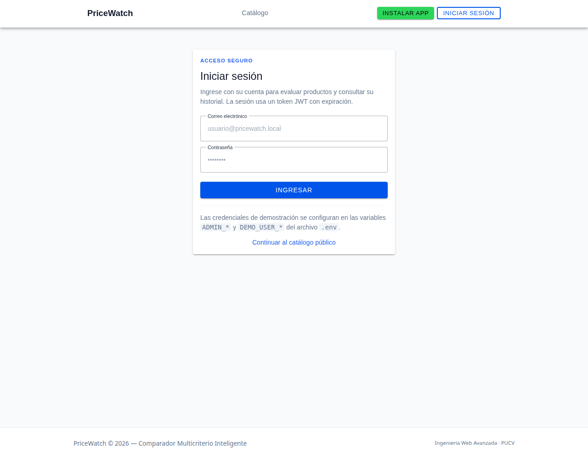
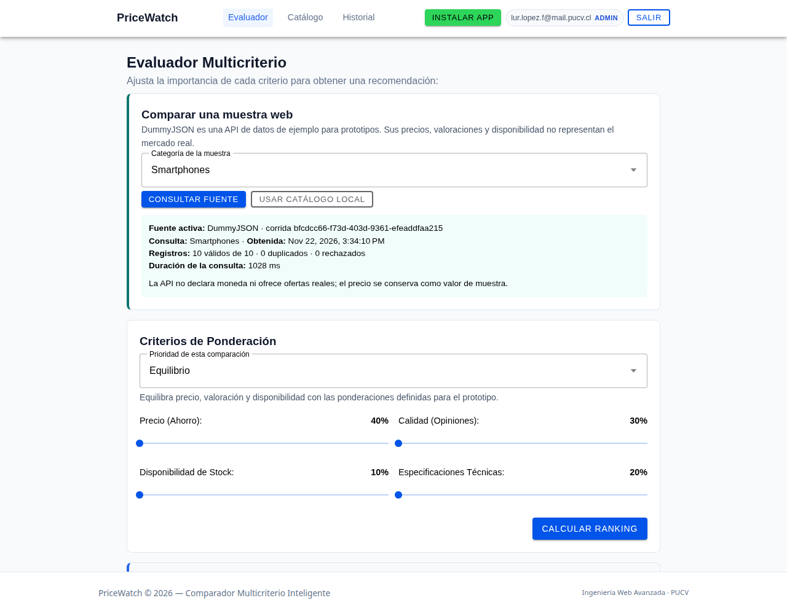
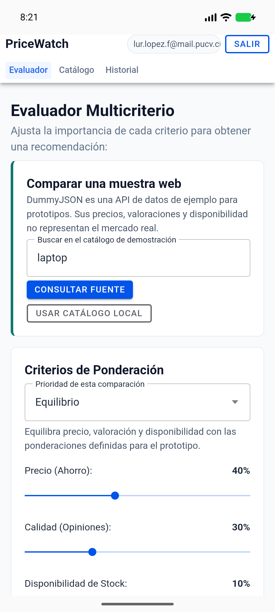

# PriceWatch — Comparador Multicriterio Inteligente

> **Asignatura:** OII436-1 Ingeniería Web Avanzada — PUCV
> **Autor:** Lur Lopez Fraile (`lur.lopez.f@mail.pucv.cl`)
> **Entrega actual:** EF — solución desplegable con autenticación, Ionic, PWA y Android
> **Estado:** autenticación JWT/roles, formularios reactivos, componentes Ionic, PWA instalable y APK Android verificados; la fuente aporta datos sintéticos de demostración

PriceWatch compara productos de comercio electrónico con **múltiples criterios ponderables por el usuario** (precio, calidad, stock y especificaciones) y entrega un ranking **explicable**: no solo dice qué producto conviene, sino por qué, mostrando la normalización y el aporte de cada criterio al puntaje final.

---

## 1. Definición del proyecto

### 1.1 Problema

Los comparadores de precios actuales ordenan el catálogo por un **criterio único**: el precio más bajo o el producto patrocinado por el comercio. Esto ignora las prioridades reales de cada comprador (por ejemplo, alguien que valora más la calidad o la disponibilidad) y no es transparente: el usuario no sabe por qué un producto aparece primero.

### 1.2 Usuarios objetivo

| Perfil | Necesidad principal |
|---|---|
| Compradores analíticos | Comparaciones objetivas con evidencia, no publicidad |
| Profesionales técnicos | Ponderar especificaciones por sobre el precio |
| Usuarios con presupuesto acotado | Maximizar relación precio/beneficio con control del peso del precio |
| Administradores y auditores | Revisar el criterio de evaluación y el historial de rankings |

### 1.3 Objetivos

1. Implementar una evaluación multicriterio ponderable mediante el método **MAUT** con normalización **Min-Max**.
2. Entregar resultados **explicables**: desglose por criterio, aportes ponderados y justificación textual.
3. Construir una arquitectura web de tres capas (cliente, API gateway, motor analítico) con persistencia real.
4. Automatizar la calidad y seguridad con un pipeline **DevSecOps** que bloquee entregas defectuosas.
5. Lograr una aplicación adaptable a escritorio, web móvil y Android.

### 1.4 Alcance de la entrega final

**Incluye:**

- Flujo vertical completo: frontend Angular/Ionic/PWA/Android → API NestJS → motor FastAPI → PostgreSQL.
- Autenticación JWT con usuarios persistidos, roles `ADMIN`/`USER`, guards, interceptor y login en el frontend.
- Catálogo persistido, evaluación multicriterio, historial por usuario y degradación elegante.
- Obtención acotada desde una API de demostración, preparación trazable y métricas de calidad.
- Perfiles adaptativos explicables, evaluación contra una versión base y prueba de sesgo de marca.
- PWA instalable, APK Android generado y probado en emulador.
- Docker Compose de desarrollo y staging, imágenes multi-stage, pipeline DevSecOps, Terraform y rollback.
- Observabilidad con logs JSON, request ID correlacionado, métricas y health checks.
- Documentación técnica, ADRs, prototipo navegable y guion de demo/defensa.

**Fuera de alcance:** precios reales, scraping de sitios con restricciones, refresh tokens, MFA, estudio formal con usuarios y versión iOS (opcional según el enunciado).

### 1.5 Funcionalidades

| # | Funcionalidad | Descripción |
|---|---|---|
| F1 | Catálogo | Lista de productos con precio, categoría, marca, calidad, stock y specs; búsqueda por texto y filtro por categoría en la API |
| F2 | Evaluador ponderado | 4 sliders (precio, calidad, stock, specs); los pesos se normalizan si no suman 1 |
| F3 | Ranking explicado | Posición, puntaje 0–100, nivel y desglose por criterio con aportes ponderados |
| F4 | Explicación global | Producto ganador, texto explicativo y advertencias de stock crítico o agotado |
| F5 | Historial | Registro persistido de cada evaluación (pesos, ganador, explicación y fecha) |
| F6 | Salud del sistema | `GET /api/health` verifica NestJS + PostgreSQL + FastAPI |
| F7 | Login JWT | `POST /api/auth/login` valida usuarios persistidos con bcrypt y emite un JWT con expiración |
| F8 | Degradación elegante | Si FastAPI falla, NestJS responde `success_fallback` con un ranking de respaldo, nunca un error 500 |
| F9 | Autenticación y autorización | JWT con expiración, contraseñas con `bcrypt`, roles `ADMIN`/`USER`, guards de ruta y protección de endpoints |
| F10 | PWA y Android | Manifest, service worker, iconos, instalación, caché del catálogo y aviso offline; APK Android con Capacitor |
| F11 | Ionic y formularios reactivos | Componentes `ion-*` en navegación, tarjetas, entradas, selects, sliders, badges y spinners; login, catálogo y evaluador con `ReactiveFormsModule` y validadores |
| F12 | Observabilidad y seguridad | Logs JSON, `x-request-id` correlacionado NestJS↔FastAPI, `/api/metrics`, Helmet, CORS, rate limiting y filtro global de errores |
| F13 | DevSecOps y staging | CI con pruebas, cobertura, Gitleaks, pip-audit, Trivy y quality gate; imágenes GHCR, Compose de staging, health check y rollback |

**Niveles del ranking:** `>= 80` Altamente Recomendado · `>= 60` Recomendado · `>= 40` Aceptable · `< 40` No Favorable.

### 1.6 Fuente web

- **EP1:** catálogo local de productos de ejemplo cargado por seed.
- **EP2:** [DummyJSON Products](https://dummyjson.com/docs/products), API que declara ofrecer datos de ejemplo para pruebas y prototipos. La interfaz permite **elegir una categoría** (Laptops, Smartphones, Fragancias, etc.); el backend consulta `/products/category/{slug}`, solicita una página (máximo 20 registros), usa timeout y valida/deduplica antes de persistir la corrida.
- **Límite:** sus precios, valoraciones y disponibilidad son sintéticos; la API no declara moneda. No se presentan como precios ni stock reales y se descartan imágenes, reseñas y datos de personas.
- Mercado Libre no se integra: sus términos contienen restricciones sobre productos que compiten con sus servicios, y el acceso observado sin autorización respondió 403. Su uso requiere revisión y permiso; no se eluden controles.

### 1.7 Capacidad adaptativa

- **Adaptación por reglas:** perfiles `economia`, `equilibrado` y `valoraciones` proponen pesos iniciales; `personalizado` permite ajustarlos.
- **Transparencia:** los sliders son pesos relativos (no es obligatorio que sumen 100 %); el motor los normaliza, omite criterios sin datos comparables y muestra la suma actual, los pesos efectivos y los criterios usados/omitidos. No hay entrenamiento ni inferencia de datos personales.
- **Interfaz adaptable:** diseño responsive con Angular e Ionic para escritorio, tablet y móvil.
- **Multiplataforma:** proyecto Android nativo en `frontend/android/`, APK debug generado y login verificado en emulador; PWA instalable con service worker y caché del catálogo.
- **Sistema tolerante a fallos:** timeouts de 4 s hacia el motor analítico y fallback con advertencia explícita al usuario.
- **Arquitectura escalable:** servicios desacoplados (NestJS orquesta, FastAPI calcula) que pueden escalar o reemplazarse de forma independiente.
- **Evaluación:** comparación reproducible contra pesos iguales; `valoraciones` cambia el ganador y el top-3 baja a 1/3 de solapamiento. Detalle en [`docs/evaluacion-adaptacion.md`](docs/evaluacion-adaptacion.md).

---

## 2. Arquitectura

```text
Navegador / móvil
        │  Angular + Ionic (4200 / Nginx :80)
        │  GET /api/products · POST /api/sources/demo-products/search
        │  POST /api/ranking/evaluate
        ▼
NestJS API Gateway (3000)
  ├── JWT + roles (ADMIN/USER) ── bcrypt
  ├── Prisma ORM ──────► PostgreSQL 16 (5432)
  └── HTTP ─► FastAPI (8000) ── adquisición/preparación + MAUT + explicación
                           └── HTTPS puntual ─► DummyJSON (datos de demostración)
```

| Capa | Tecnología |
|---|---|
| Frontend | Ionic 9 + Angular 21 standalone + Capacitor + Nginx |
| Backend | NestJS 11 + Prisma ORM + class-validator + Swagger |
| Base de datos | PostgreSQL 16 (Docker + volumen persistente) |
| Motor analítico | Python 3.12 + FastAPI + MAUT (Min-Max), preparación de fuente y adaptación por reglas |
| Infraestructura | Docker Compose (dev/staging) + Terraform (manifiesto local y módulo Docker con red, volumen y PostgreSQL) |
| CI/CD | GitHub Actions: lint, tests, cobertura, auditoría, Gitleaks, pip-audit, Trivy, integración, deploy y rollback |
| Calidad | oxlint, flake8, pytest, Jest, Vitest y smoke test de extremo a extremo |
| Observabilidad | Logs JSON, request ID, métricas, health checks y rate limiting |

---

## 3. Estructura del repositorio

```text
PriceWatch/
├── .github/workflows/
│   ├── ci.yml                  # Pipeline DevSecOps + integración + quality gate
│   ├── deploy-staging.yml      # Build/push GHCR + deploy SSH + health check
│   └── rollback-staging.yml    # Rollback manual por tag
├── backend/                    # API NestJS + Prisma + JWT + observabilidad
│   ├── prisma/migrations/      # Migraciones versionadas
│   └── src/auth, common, metrics
├── frontend/                   # Angular + Ionic + PWA
│   ├── android/                # Proyecto nativo Capacitor
│   ├── public/icons/           # Iconos PWA
│   ├── ngsw-config.json
│   └── src/app/pages, guards, interceptors, services
├── python-service/             # FastAPI + MAUT + fuente + evaluación
│   ├── evaluation/             # Comparación de perfiles y resultados
│   └── tests/
├── infra/                      # Terraform: manifiesto staging
│   └── docker-staging/         # Terraform Docker: red, volumen y PostgreSQL
├── scripts/                    # smoke-test, deploy, healthcheck, rollback
├── docs/                       # ADRs, arquitectura, seguridad, observabilidad, prototipo
├── ep2/                        # Plan y decisión de fuente de EP2
├── .env.example                # Plantilla de variables (versionada)
├── docker-compose.yml          # Stack de desarrollo
├── docker-compose.staging.yml  # Stack de staging con imágenes GHCR
├── CONTRIBUTING.md
└── README.md
```

> La solución completa está implementada. Para la demostración se recomienda reconstruir las imágenes (`docker compose up --build -d`) y verificar con `docker compose ps` y `./scripts/smoke-test.sh`.

---

## 4. Instalación

### 4.1 Docker Compose (recomendado)

```bash
cp .env.example .env          # editar contraseñas y habilitar la API de muestra localmente
# En .env: DEMO_PRODUCTS_SOURCE_ENABLED=true
# El .env.example usa BACKEND_PORT=3001 y FRONTEND_PORT=4200.
docker compose config -q
docker compose up --build -d
docker compose ps
curl localhost:8000/health
curl localhost:3001/api/health
curl localhost:3001/api/products
curl localhost:4200/api/health
```

El stack levanta cuatro servicios: PostgreSQL, FastAPI, NestJS y Nginx. La interfaz web queda en `http://localhost:4200` (o `FRONTEND_PORT`). Para detener: `docker compose down` (agregar `-v` solo si se quiere borrar la base).

Al iniciar, el backend ejecuta `prisma migrate deploy` y el seed de productos y usuarios. Si la base fue creada con `prisma db push` en EP1/EP2, el entrypoint detecta el estado y marca la migración base como aplicada sin borrar los datos existentes. Las credenciales de los usuarios seed se toman de `ADMIN_*` y `DEMO_USER_*`; `JWT_SECRET` firma los tokens.

Si un puerto está ocupado, revisa el proceso con `ss -ltnp | grep :PUERTO` y deténlo, o cambia `POSTGRES_PORT`, `PYTHON_PORT`, `BACKEND_PORT` o `FRONTEND_PORT` en `.env` antes de levantar el stack.

### 4.2 Ejecución manual (desarrollo)

**Base de datos:**

```bash
docker run -d --name pw-db -e POSTGRES_PASSWORD=pricewatch \
  -e POSTGRES_USER=pricewatch_admin -e POSTGRES_DB=pricewatch_db \
  -p 5432:5432 postgres:16-alpine
```

**Motor analítico (Python):**

```bash
cd python-service
python3 -m venv .venv && source .venv/bin/activate
pip install -r requirements.txt -r requirements-dev.txt
export DEMO_PRODUCTS_SOURCE_ENABLED=true
uvicorn main:app --port 8000 --reload
```

**Backend (NestJS):**

```bash
cd backend
npm ci
npx prisma generate
npx prisma migrate deploy
npx prisma db seed
export DEMO_PRODUCTS_SOURCE_ENABLED=true
export JWT_SECRET=dev_secret_min_32_chars
export ADMIN_EMAIL=admin@pricewatch.local
export ADMIN_PASSWORD=change_me_admin
export DEMO_USER_EMAIL=user@pricewatch.local
export DEMO_USER_PASSWORD=change_me_user
npm run start:dev
```

> Al ejecutar fuera de Docker, ajustar `DATABASE_URL` y `PYTHON_SERVICE_URL` en `.env` para usar `localhost` en vez de los nombres de servicio.
> La bandera `DEMO_PRODUCTS_SOURCE_ENABLED=true` debe estar disponible tanto para NestJS como para FastAPI durante una demo local; no habilitarla en staging público sin protección de acceso.

**Frontend (Ionic):**

```bash
cd frontend
npm ci
npm start                     # proxy /api → http://localhost:3000
```

---

## 5. Contratos de API

| Método | Endpoint (NestJS :3000) | Descripción |
|---|---|---|
| `GET` | `/api/health` | Estado de NestJS + PostgreSQL + FastAPI |
| `GET` | `/api/metrics` | Métricas operativas básicas (solo ADMIN) |
| `GET` | `/api/docs` | Swagger / OpenAPI |
| `POST` | `/api/auth/login` | Login con email/contraseña → token JWT |
| `GET` | `/api/auth/me` | Perfil del usuario autenticado (JWT) |
| `POST` | `/api/auth/logout` | Cierre de sesión del cliente (JWT) |
| `GET` | `/api/products?category=` | Catálogo desde PostgreSQL (público) |
| `GET` | `/api/products/:id` | Detalle de producto (público) |
| `POST` | `/api/ranking/evaluate` | Evaluación multicriterio (USER/ADMIN) |
| `GET` | `/api/ranking/history` | Historial del usuario autenticado (USER/ADMIN) |
| `POST` | `/api/sources/demo-products/search` | Consulta una categoría de DummyJSON (solo ADMIN) |
| `GET` | `/api/sources/demo-products/runs` | Corridas de fuente (solo ADMIN) |
| `GET` | `/api/sources/demo-products/runs/:id` | Corrida y registros normalizados (solo ADMIN) |
| `GET` | `/health` (FastAPI :8000) | Salud del motor analítico |
| `POST` | `/evaluate` (FastAPI :8000) | Cálculo MAUT |
| `POST` | `/sources/demo-products/search` (FastAPI :8000) | Consulta interna de la API de muestra |

**Búsqueda explícita de una muestra:**

```json
POST /api/sources/demo-products/search
{
  "query": "Laptops",
  "category": "laptops",
  "limit": 10,
  "acknowledged": true
}
```

La respuesta contiene `run_id`, fecha, métricas y registros normalizados con `content_hash` y `source_url`. Para comparar esa muestra, incluye el `run_id` en `POST /api/ranking/evaluate`; no mezcles valores de moneda desconocida con el catálogo local.

**Payload `POST /api/ranking/evaluate`:**

```json
{
  "weights": {
    "weight_price": 0.35,
    "weight_quality": 0.30,
    "weight_stock": 0.15,
    "weight_specs": 0.20
  },
  "context_profile": "equilibrado",
  "category": "Laptops"
}
```

Para evaluar una corrida obtenida desde la fuente, añade `"source_run_id": "<id de corrida>"`.
Los perfiles admitidos son `economia`, `equilibrado`, `valoraciones` y `personalizado`.
Los criterios ausentes en uno o más productos se omiten para toda la muestra y los pesos restantes se normalizan.

---

## 6. Seguridad y autorización

- **Contraseñas:** almacenadas con `bcrypt` (10 rondas); nunca se devuelven en las respuestas.
- **Tokens:** JWT firmado con `JWT_SECRET`, expiración configurable con `JWT_EXPIRES_IN` (por defecto `1h`).
- **Roles:** `ADMIN` y `USER`. El rol viaja en el token y se valida con `JwtAuthGuard` + `RolesGuard`.
- **Endpoints públicos:** catálogo y salud. **USER:** evaluación e historial propio. **ADMIN:** consulta de fuentes y visionado global del historial.
- **Frontend:** `authInterceptor` añade el token, `authGuard` protege evaluador e historial, y un 401 limpia la sesión y redirige al login.
- **Migraciones:** el backend aplica `prisma migrate deploy` al iniciar; si detecta una base creada con `db push`, marca la migración base como aplicada sin borrar datos.
- **Cabeceras y límites:** `helmet`, CORS configurable, cuerpo máximo de 100 KB y `@nestjs/throttler` (120/min global, 5/min en login, 10/min en fuente).
- **Observabilidad:** logs JSON con `x-request-id` correlacionado entre NestJS y FastAPI, `GET /api/metrics` para ADMIN y health checks en cada servicio. Detalle en [`docs/observabilidad.md`](docs/observabilidad.md).
- **Seguridad y privacidad:** modelo STRIDE, roles, minimización de datos y ética de la fuente en [`docs/seguridad.md`](docs/seguridad.md).

**Login de demostración:**

```bash
curl -X POST http://localhost:3000/api/auth/login \
  -H 'Content-Type: application/json' \
  -d '{"email":"admin@pricewatch.local","password":"<ADMIN_PASSWORD>"}'
```

Las credenciales se configuran en `.env` mediante `ADMIN_EMAIL`/`ADMIN_PASSWORD` y `DEMO_USER_EMAIL`/`DEMO_USER_PASSWORD`. El archivo `.env` no se versiona.

## 7. Pruebas

| Componente | Comando | Cobertura |
|---|---|---|
| python-service | `pytest -q --cov=.` · `flake8 .` | Extracción, limpieza, deduplicación, perfiles, datos faltantes, métricas, request ID y evaluación adaptativa. Cobertura total 90 % (98 % en main.py y 88 % en sources.py). |
| backend | `npm run test:cov` · `npm run lint` · `npm run build` · `npm run test:e2e` | Auth JWT, roles, guards, request ID, métricas, filtros, fuente, ranking, fallback y contrato HTTP |
| frontend | `npm run test:coverage` · `npm run build` | Login, catálogo, historial, AuthService, guard, interceptor, formularios reactivos y errores. Cobertura ~40 % de líneas. |
| infra | `terraform fmt -check` · `terraform validate` | Sintaxis y validez del manifiesto staging |

Verificación local: **31 pruebas Jest**, **6 pruebas e2e**, **28 pruebas Vitest**, **22 pruebas pytest** y `flake8` sin errores. Las pruebas no realizan llamadas externas. FastAPI reporta 90 % de cobertura total; el frontend reporta ~40 % de líneas y el backend genera reporte de cobertura en CI.

**Verificación de autenticación (21/11/2026):** con PostgreSQL temporal se aplicaron las dos migraciones y el seed. Se comprobó login `ADMIN` (200), `/api/auth/me` (200), historial sin token (401), usuario `USER` intentando consultar fuentes (403), evaluación autenticada (201) e historial filtrado por usuario. También se simuló una base creada con `db push`: el baseline marcó la migración inicial como aplicada y conservó los datos existentes.

**Sonda de la fuente (22/10/2026):** una consulta `laptop` devolvió 5 registros aceptados, 0 rechazados y 0 duplicados. En esa muestra sintética, `economia` eligió Lenovo Yoga 920 (83,53/100) y `valoraciones` eligió Huawei Matebook X Pro (94,08/100). La sonda pasó por FastAPI en memoria. Además, una prueba integrada por NestJS creó una corrida persistida y guardó un ranking en el historial. **Los datos son sintéticos, no precios reales.** Detalles en [`ep2/PLAN-EP2.md`](ep2/PLAN-EP2.md).

---

## 8. Pipeline DevSecOps

Workflow `.github/workflows/ci.yml` con jobs independientes y un **quality gate** final:

1. **frontend:** `npm ci` → Prettier → build PWA → Vitest con cobertura → `npm audit --omit=dev`.
2. **backend:** `npm ci` → `prisma generate`/`validate` → oxlint → build → Jest con cobertura → e2e → `npm audit`.
3. **python-service:** instalación → `flake8` → `pytest --cov` → `pip-audit`.
4. **terraform:** `fmt -check` → `init` → `validate` → `plan` para el manifiesto y para el módulo Docker.
5. **secret-scan:** Gitleaks sobre todo el historial.
6. **docker-build:** construye las 3 imágenes y las escanea con **Trivy** (falla ante vulnerabilidades críticas).
7. **integration:** levanta el stack con Docker Compose y ejecuta `scripts/smoke-test.sh` sobre el flujo real.
8. **quality-gate:** solo pasa si todos los controles anteriores pasan.

Workflows adicionales:

- `.github/workflows/deploy-staging.yml`: construye y publica imágenes en GHCR, despliega por SSH, ejecuta health check y hace rollback si falla.
- `.github/workflows/rollback-staging.yml`: rollback manual por tag.

Los secretos se configuran en GitHub Actions Secrets y la configuración no sensible en Variables. El pipeline no imprime credenciales.

> **Nota de entorno:** en el repositorio de entrega, GitHub Actions mostró jobs con 0 pasos y fallo inmediato (antes de ejecutar el runner). El YAML y todos los jobs se validaron/ejecutaron localmente. Revisar **Settings → Actions** y el límite de minutos de la cuenta; ver [`docs/despliegue.md`](docs/despliegue.md#11-nota-de-entorno-github-actions).

---

## 9. Variables y secretos

`cp .env.example .env` y ajustar los valores. El `.env` real está excluido por `.gitignore`; solo se versiona `.env.example`.

| Variable | Descripción |
|---|---|
| `NODE_ENV` | Entorno de ejecución Node |
| `ENVIRONMENT` | Ambiente del despliegue (staging/managed por Terraform) |
| `POSTGRES_DB` / `POSTGRES_USER` / `POSTGRES_PASSWORD` | Credenciales de PostgreSQL |
| `POSTGRES_PORT` | Puerto expuesto de la base |
| `DATABASE_URL` | Cadena de conexión de Prisma |
| `PORT` / `BACKEND_PORT` | Puerto del backend NestJS |
| `PYTHON_SERVICE_URL` / `PYTHON_PORT` | Ubicación y puerto del motor FastAPI |
| `FRONTEND_PORT` | Puerto del cliente |
| `CORS_ORIGIN` | Origen permitido por NestJS (`*` en desarrollo) |
| `ADMIN_EMAIL` / `ADMIN_PASSWORD` | Credenciales del usuario administrador (seed) |
| `DEMO_USER_EMAIL` / `DEMO_USER_PASSWORD` | Credenciales del usuario de demostración con rol `USER` (seed) |
| `JWT_SECRET` | Clave de firma de los tokens; obligatoria en producción |
| `JWT_EXPIRES_IN` | Duración del token (por defecto `1h`) |
| `DEMO_PRODUCTS_SOURCE_ENABLED` | Habilita la consulta explícita de DummyJSON; falso por defecto |

En GitHub Actions no se realizan consultas externas; las pruebas usan transporte HTTP simulado. La bandera de fuente permanece desactivada por defecto en CI. **No habilitarla en un despliegue público sin proteger la ruta de consulta y revisar las condiciones de la fuente.**

---

## 10. Prototipo navegable, PWA y Android

El prototipo navegable es la aplicación Angular/Ionic incluida en `frontend/`. Se puede abrir con Docker Compose en `http://localhost:4200`, iniciar sesión con las credenciales configuradas en `.env` y recorrer las vistas de evaluador, catálogo e historial. El catálogo es público; evaluador e historial requieren sesión.

**Interfaz y formularios**

- Componentes Ionic reales: `ion-header`, `ion-toolbar`, `ion-card`, `ion-input`, `ion-select`, `ion-range`, `ion-button`, `ion-badge`, `ion-spinner` e `ion-note`.
- Formularios reactivos con `ReactiveFormsModule` y validadores en login, catálogo y evaluador.
- Estado reactivo con Signals para autenticación, conectividad y PWA; `zone.js` se mantiene para la detección de cambios de Angular.
- Diseño responsive probado en escritorio y móvil; tabla de ranking con desplazamiento horizontal controlado.
- Accesibilidad: etiquetas en controles, `aria-live` para mensajes, foco visible y contraste ajustado.





### PWA

- Manifest `public/manifest.webmanifest` con iconos de 72 a 512 px y variante maskable.
- Service worker Angular (`ngsw-config.json`) con precarga del app shell e iconos.
- Caché `freshness` para el catálogo público (`/api/products`) con TTL de 1 hora.
- Instalación desde el navegador mediante el botón “Instalar app”.
- Aviso de actualización disponible y recarga controlada.
- Banner de conectividad: el catálogo puede verse desde caché; evaluador e historial requieren red.

```bash
cd frontend
npm run build
# servir dist/frontend/browser por HTTP (no file://) para probar el service worker
npx http-server dist/frontend/browser -p 8080
```

### Android

- Proyecto nativo en `frontend/android/` generado con Capacitor.
- APK debug: `frontend/android/app/build/outputs/apk/debug/app-debug.apk`.
- La app Android usa una URL absoluta (`environment.apiBaseUrlNative`) porque el WebView no tiene el proxy de Nginx.
- Para el emulador, `10.0.2.2:3001` apunta al backend del host. Para un dispositivo físico o staging, cambiar esa URL y agregar el dominio a `network_security_config.xml`.

```bash
cd frontend
npm run build
npx cap sync android
export JAVA_HOME=/usr/lib/jvm/java-21-openjdk-amd64
export ANDROID_HOME=/home/lur/android-sdk
cd android
./gradlew assembleDebug
/home/lur/android-sdk/platform-tools/adb install -r app/build/outputs/apk/debug/app-debug.apk
```

Probado en emulador Android: login contra el backend local y navegación al evaluador. La versión de producción debe apuntar a la URL HTTPS de staging.



### Prototipo y Figma

El prototipo navegable funcional es la aplicación en `http://localhost:4200`. Además, `docs/prototipo/index.html` permite recorrer las capturas de login, evaluador, catálogo e historial. Las instrucciones para importarlas a Figma están en [`docs/prototipo/README.md`](docs/prototipo/README.md).

**Figma:** pendiente de crear el archivo con una cuenta del equipo y pegar el enlace público. El repositorio ya incluye los frames y el guion de importación.

---

## 11. Despliegue en staging

La solución incluye un stack de staging reproducible:

- `docker-compose.staging.yml` con imágenes GHCR, red interna, volumen persistente, health checks y logs rotados.
- `.github/workflows/deploy-staging.yml`: build/push a GHCR, deploy por SSH, health check y rollback automático.
- `.github/workflows/rollback-staging.yml`: rollback manual por tag.
- `scripts/deploy.sh`, `scripts/healthcheck.sh`, `scripts/rollback.sh`.
- `scripts/smoke-test.sh`: flujo completo login → catálogo → ranking → historial → métricas.

Instrucciones, variables de GitHub y rollback en [`docs/despliegue.md`](docs/despliegue.md). El compose de staging se probó localmente con imágenes `local/*:test` y el smoke test pasó. La URL pública queda pendiente de configurar un VPS/dominio y los secretos `STAGING_*`.

---

## 12. Evaluación de la adaptación

Se comparó el ranking con una base de pesos iguales:

| Perfil | Ganador | Top-3 con base | Spearman |
|---|---|---:|---:|
| base (0,25 cada uno) | Acer Aspire 3 | 3/3 | 1,0000 |
| economia | Acer Aspire 3 | 2/3 | 0,9524 |
| equilibrado | Acer Aspire 3 | 2/3 | 0,9524 |
| valoraciones | MacBook Air M2 | 1/3 | 0,2143 |

- La prueba de **marca ciega** confirmó puntajes idénticos al cambiar solo la marca.
- Con datos faltantes, `specs` se omite para toda la muestra y los pesos se renormalizan.
- Script reproducible: `python-service/evaluation/compare_profiles.py`.
- Resultados y limitaciones: [`docs/evaluacion-adaptacion.md`](docs/evaluacion-adaptacion.md).

---

## 13. Demo y defensa

Guion completo en [`docs/guia-demo-defensa.md`](docs/guia-demo-defensa.md). Los 8 escenarios son:

1. Funcionamiento normal: login, catálogo, evaluación, historial.
2. Adaptación: cambio de perfil y ganador.
3. Información web: consulta DummyJSON, trazabilidad y métricas.
4. Pipeline: GitHub Actions con tests, Trivy y quality gate.
5. Pruebas: Jest, Vitest, pytest y cobertura.
6. Seguridad: 401 sin token, 403 para `USER`, Gitleaks/Trivy.
7. Observabilidad: health, logs JSON, request ID y `/api/metrics`.
8. Error controlado: FastAPI caído y fallback; PostgreSQL caído y health 503.

La defensa individual debe explicar arquitectura, flujo, auth, base de datos, Docker, CI, Terraform, pruebas, adaptación y límites. Cada integrante debe poder explicar el código que aparece en el repositorio.

---

## 14. Licencia, autoría y responsabilidades

- **Autor:** Lur Lopez Fraile.
- **Roles asumidos:** arquitectura, frontend, backend, persistencia, servicio Python, DevSecOps, seguridad, pruebas, documentación y UX.
- **Licencia:** MIT, ver [`LICENSE`](LICENSE).
- **Uso de IA:** declarado en la sección 16 y en el README de cada entrega.

Si el proyecto se presenta en equipo, reemplazar esta sección por la distribución real de responsabilidades y registrar la participación de cada integrante.

---

## 15. Documentación adicional

- `docs/MEMORIA-EF.md` — memoria técnica completa de la entrega final (también en `.docx`).
- `docs/arquitectura-final.md` — arquitectura, diagramas y flujo de datos final.
- `docs/modelo-datos-final.md` — modelo conceptual/lógico y migraciones.
- `docs/seguridad.md` — STRIDE, roles, secretos, privacidad y ética.
- `docs/observabilidad.md` — logs, request ID, métricas y health checks.
- `docs/despliegue.md` — staging, GHCR, deploy, health check y rollback.
- `docs/evaluacion-adaptacion.md` — comparación de perfiles, métricas y límites.
- `docs/guia-demo-defensa.md` — 8 escenarios de demo y preguntas de defensa.
- `docs/prototipo/` — capturas y visor HTML para Figma.
- `docs/adr/` — ADR-001 a ADR-007.
- `ep2/PLAN-EP2.md`, `ep2/ADR-003-fuente-y-adaptacion.md`, `ep2/GUIA-DEFENSA.md` — antecedentes de EP2.
- `CONTRIBUTING.md` — GitFlow, commits convencionales y verificación local.
- `LICENSE` — licencia MIT.
