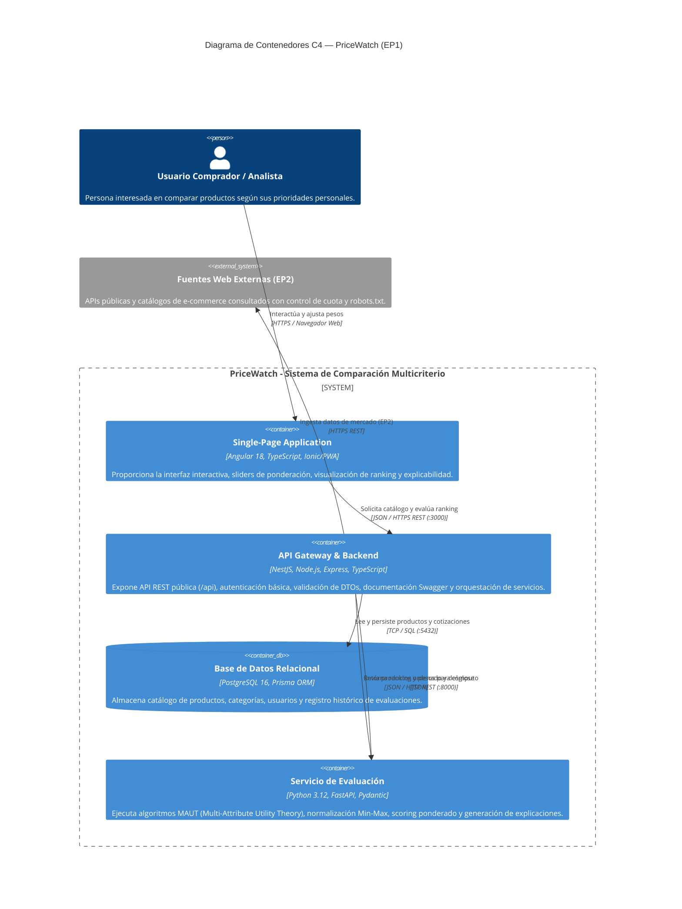

# Diagrama de Contenedores (C4 Container Diagram) — EP1

> **Proyecto:** PriceWatch — Comparador Multicriterio Inteligente  
> **Entrega:** Parcial 1 (EP1)  
> **Estándar:** Modelo C4 — Nivel 2: Contenedores

---

## 1. Descripción de la Arquitectura de Contenedores

El modelo de contenedores C4 describe las unidades de software ejecutables por separado dentro del límite del sistema **PriceWatch**, detallando tecnologías, responsabilidades y protocolos de comunicación.

---

## 2. Matriz de Responsabilidades y Protocolos

| Contenedor | Tecnología Principal | Puerto Expuesto | Rol y Responsabilidad |
|---|---|---|---|
| **Frontend Web** | Angular 18 + Ionic + PWA | `4200` (Nginx:80) | Interfaz SPA reactiva, gestión de estado de pesos, renderizado de tarjetas de producto y métricas. |
| **Backend API** | NestJS 11 + Node.js | `3000` | Punto de entrada único, validación de esquemas con class-validator, documentación OpenAPI/Swagger en `/api/docs`. |
| **Servicio de Ranking** | Python 3.12 + FastAPI | `8000` (Interno) | Normalización matemática min-max, cálculo de funciones de utilidad, generación de texto explicativo y alertas. |
| **Base de Datos** | PostgreSQL 16 Alpine | `5432` | Persistencia relacional ACID, esquemas versionados mediante migraciones de Prisma ORM. |

---

## 3. Principio de Aislamiento

1. **NestJS como Única Puerta de Entrada:** El cliente Angular nunca invoca directamente a PostgreSQL ni a FastAPI. Todo el tráfico pasa por NestJS, lo que garantiza auditoría, autenticación homogénea y control centralizado de errores.
2. **FastAPI como Microservicio de Cómputo Puro:** El servicio en Python es *stateless*; no requiere conexión directa a PostgreSQL ni credenciales de base de datos, cumpliendo con el principio de mínimo privilegio.
