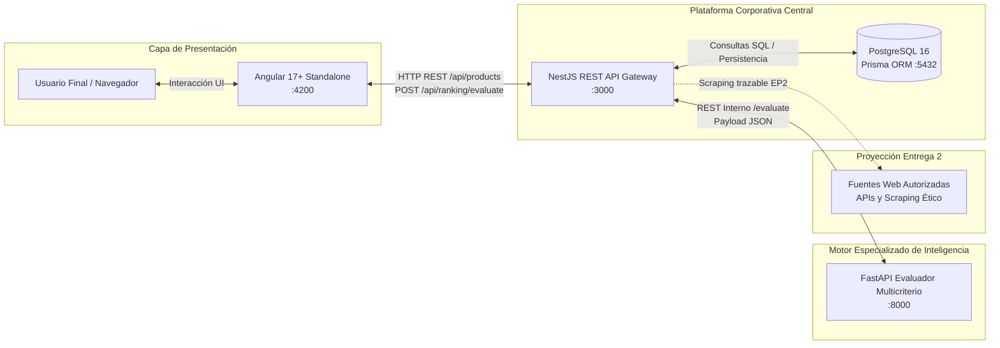

# Diagrama de Contexto y Flujo de Comunicación — EP1

> **Proyecto:** PriceWatch — Comparador Multicriterio Inteligente  
> **Entrega:** Parcial 1 (EP1)

---

## 1. Diagrama de Contexto del Sistema

El siguiente diagrama modela las fronteras del sistema, los componentes involucrados y los protocolos de comunicación utilizados:

---

## 2. Flujo Demostrable de Extremo a Extremo (EP1)

1. **Carga Inicial de Productos:**
   - El usuario accede a `http://localhost:4200`.
   - Angular solicita `GET /api/products` a NestJS.
   - NestJS consulta el catálogo en PostgreSQL y retorna los productos con sus atributos crudos (precio, rating, stock, especificaciones).
   - Angular renderiza el catálogo inicial y los controles de ponderación.

2. **Ajuste de Ponderaciones y Evaluación:**
   - El usuario modifica los controles deslizantes (*sliders*):
     - Ej: `pesoPrecio = 0.40`, `pesoCalidad = 0.35`, `pesoStock = 0.15`, `pesoSpecs = 0.10`.
   - Angular envía una solicitud `POST /api/ranking/evaluate` a NestJS con el vector de pesos y los filtros deseados.
   - NestJS valida el DTO y realiza una llamada HTTP interna a `http://python-service:8000/evaluate`.
   - El motor FastAPI:
     1. Aplica normalización Min-Max (el precio se invierte: menor precio = mayor puntaje).
     2. Calcula la función de utilidad ponderada:
        $$\text{Score}(P) = 100 \times \left( w_p \cdot \hat{P}_{\text{precio}} + w_c \cdot \hat{P}_{\text{calidad}} + w_s \cdot \hat{P}_{\text{stock}} + w_e \cdot \hat{P}_{\text{specs}} \right)$$
     3. Ordena los productos de mayor a menor score.
     4. Genera advertencias y una explicación en lenguaje natural para la alternativa líder.
   - NestJS registra la consulta en la tabla `RankingHistory` de PostgreSQL y retorna el resultado enriquecido a Angular.
    - Angular actualiza la vista mostrando el ranking interactivo, los desgloses porcentuales y la tarjeta destacada con el motivo de la recomendación.
