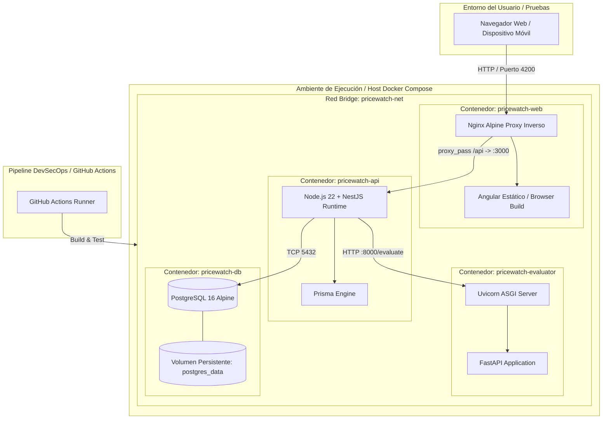

# Diagrama de Despliegue Preliminar — EP1

> **Proyecto:** PriceWatch — Comparador Multicriterio Inteligente  
> **Entrega:** Parcial 1 (EP1)

---

## 1. Topología de Despliegue Local e Infraestructura (Staging)

El siguiente diagrama muestra la arquitectura física y lógica tanto en el entorno de desarrollo local orquestado con **Docker Compose** como en la proyección de staging definida mediante **Terraform**:

---

## 2. Configuración de Redes y Aislamiento

- **Red Bridge (`pricewatch-net`):** Permite la resolución de nombres DNS interna entre contenedores (`backend`, `python-service`, `database`).
- **Exposición de Puertos:**
  - `4200:80` (Frontend): Punto de acceso para el usuario y evaluación docente.
  - `3000:3000` (Backend API): Expuesto para inspección directa de endpoints REST y Swagger (`/api/docs`).
  - `8000:8000` (FastAPI): Expuesto en desarrollo para pruebas directas con pytest/curl; aislado en producción.
  - `5432:5432` (PostgreSQL): Acceso local para herramientas de inspección (Prisma Studio / DBeaver).
- **Volúmenes Persistentes:**
  - `postgres_data:/var/lib/postgresql/data`: Asegura que el catálogo de productos y el historial no se pierdan al reiniciar contenedores.

---

## 3. Estrategia de Salud (Health Checks)

- **Database:** `pg_isready -U ${POSTGRES_USER} -d ${POSTGRES_DB}` (intervalo: 10s, reintentos: 5).
- **Backend:** `GET /api/health` retorna el estado consolidado de la base de datos y microservicios.
- **Python Service:** `GET /health` responde con código HTTP 200 y metadatos del algoritmo.
- **Frontend:** Nginx responde inmediatamente en la raíz `/` con los recursos compilados de Angular.
