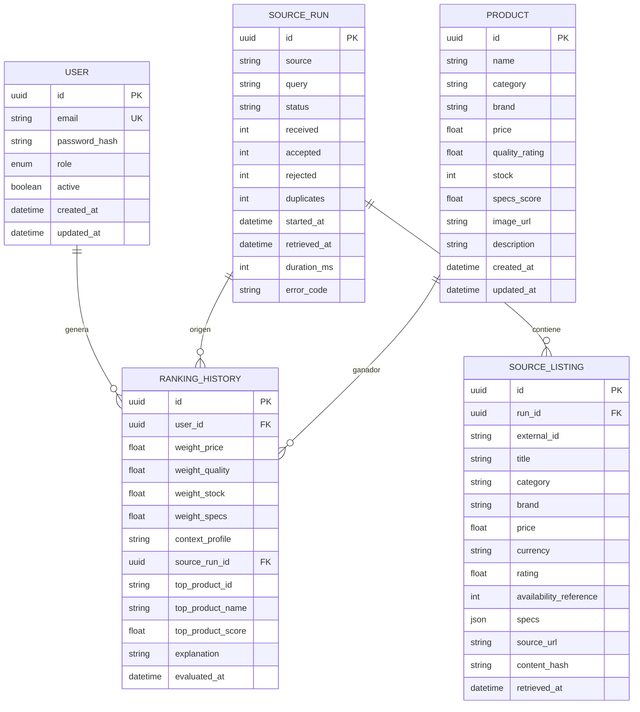

# Modelo de datos final — PriceWatch

## 1. Modelo conceptual



## 2. Modelo lógico (Prisma)

### User

| Campo | Tipo | Restricción |
|---|---|---|
| `id` | String (UUID) | PK |
| `email` | String | único, minúsculas |
| `passwordHash` | String | bcrypt, nunca expuesto |
| `role` | enum `ADMIN`/`USER` | por defecto `USER` |
| `active` | Boolean | por defecto `true` |
| `createdAt` / `updatedAt` | DateTime | auditoría |

### Product

| Campo | Tipo | Restricción |
|---|---|---|
| `id` | String (UUID) | PK |
| `name`, `category`, `brand` | String | obligatorios |
| `price` | Float | > 0 en la lógica de negocio |
| `qualityRating` | Float | 0–5 |
| `stock` | Int | >= 0 |
| `specsScore` | Float | 0–100 |
| `imageUrl`, `description` | String? | opcionales |

### RankingHistory

| Campo | Tipo | Restricción |
|---|---|---|
| `id` | String | PK |
| `userId` | String? | FK User, `SET NULL` |
| `weightPrice/Quality/Stock/Specs` | Float | pesos efectivos |
| `contextProfile` | String | perfil usado |
| `sourceRunId` | String? | FK SourceRun, `SET NULL` |
| `topProductId/Name/Score` | String/Float | ganador |
| `explanation` | String | explicación global |
| `evaluatedAt` | DateTime | índice |

### SourceRun

| Campo | Tipo | Restricción |
|---|---|---|
| `id` | String | PK |
| `source` | String | `dummyjson` |
| `query` | String | búsqueda acotada |
| `status` | String | `RUNNING`/`SUCCEEDED`/`FAILED` |
| `received/accepted/rejected/duplicates` | Int | métricas |
| `startedAt/retrievedAt/durationMs` | DateTime/Int | trazabilidad |
| `errorCode` | String? | código seguro |

### SourceListing

| Campo | Tipo | Restricción |
|---|---|---|
| `id` | String | PK |
| `runId` | String | FK SourceRun, `CASCADE` |
| `externalId` | String | único por corrida |
| `title`, `price`, `sourceUrl` | String/Float | obligatorios |
| `category`, `brand`, `currency`, `rating`, `availabilityReference`, `specs` | opcionales | datos normalizados |
| `contentHash` | String | SHA-256 |
| `retrievedAt` | DateTime | fecha de recuperación |

## 3. Índices y restricciones

- `users.email` único.
- `ranking_history.user_id, evaluated_at` índice compuesto para historial por usuario.
- `ranking_history.evaluated_at` índice para el historial global.
- `ranking_history.source_run_id` índice para trazabilidad.
- `source_listings (run_id, external_id)` único para deduplicar.
- `source_listings.external_id` índice para búsquedas.
- `source_runs (source, started_at)` índice para auditoría.

## 4. Migraciones

```text
20261121000000_init
  → products, ranking_history, source_runs, source_listings

20261121001000_auth_users
  → enum Role, users, ranking_history.user_id, índices y FK
```

- `prisma migrate deploy` se ejecuta en el entrypoint del backend.
- `prisma/baseline.js` detecta una base creada con `db push` y marca la migración base como aplicada sin borrar datos.
- El seed crea 5 productos y 2 usuarios (admin/user) desde variables de entorno.
- `prisma/seed.js` es el que usa producción/Docker; `seed.ts` queda para desarrollo.

## 5. Estrategia de inicialización

```bash
cp .env.example .env
docker compose up --build -d
# el backend aplica migraciones y seed automáticamente
```

Para desarrollo local fuera de Docker:

```bash
npx prisma generate
npx prisma migrate deploy
npx prisma db seed
```

## 6. Privacidad y minimización

- Solo se almacena correo y hash de contraseña del usuario.
- El historial guarda la decisión y los pesos, no datos personales del contexto.
- Los datos de la fuente son de productos; se descartan imágenes, reseñas y datos de personas.
- `ON DELETE SET NULL` evita perder historial si se elimina un usuario o corrida.
- El acceso al historial está filtrado por `userId`; el admin puede ver el global.
