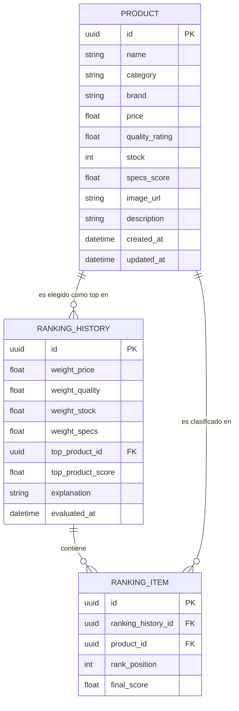

# Modelo de Datos Inicial — EP1

> **Proyecto:** PriceWatch — Comparador Multicriterio Inteligente  
> **ORM:** Prisma ORM / PostgreSQL 16

---

## 1. Diagrama Entidad-Relación (Mermaid)

El siguiente diagrama representa las entidades implementadas para la persistencia de datos en esta primera entrega:

---

## 2. Descripción de Entidades

### `PRODUCT`
Representa el catálogo de productos evaluables en el sistema.
- `id`: Identificador único UUID.
- `name`: Denominación comercial del producto.
- `category`: Categoría (ej. `Laptops`, `Monitores`, `Smartphones`).
- `brand`: Fabricante o marca.
- `price`: Precio en moneda local (CLP o EUR según configuración).
- `quality_rating`: Calificación técnica y de satisfacción de usuarios (escala 1.0 a 5.0).
- `stock`: Unidades disponibles inmediatamente para entrega.
- `specs_score`: Puntuación agregada de especificaciones técnicas (escala 1 a 100).
- `image_url`: Ruta o URL del recurso gráfico para visualización en el frontend.
- `description`: Resumen técnico del producto.

### `RANKING_HISTORY`
Registra cada simulación o evaluación ejecutada por los usuarios para garantizar **trazabilidad y observabilidad**:
- `weight_*`: Vector de ponderación aplicado en la consulta.
- `top_product_id`: Referencia al producto que obtuvo el primer puesto en el ranking.
- `top_product_score`: Puntuación alcanzada por el producto líder (0 a 100).
- `explanation`: Texto explicativo generado automáticamente por el microservicio analítico.
- `evaluated_at`: Marca temporal ISO de la evaluación.

### `RANKING_ITEM`
Almacena el detalle de las posiciones y scores calculados para cada producto en una evaluación histórica dada.
